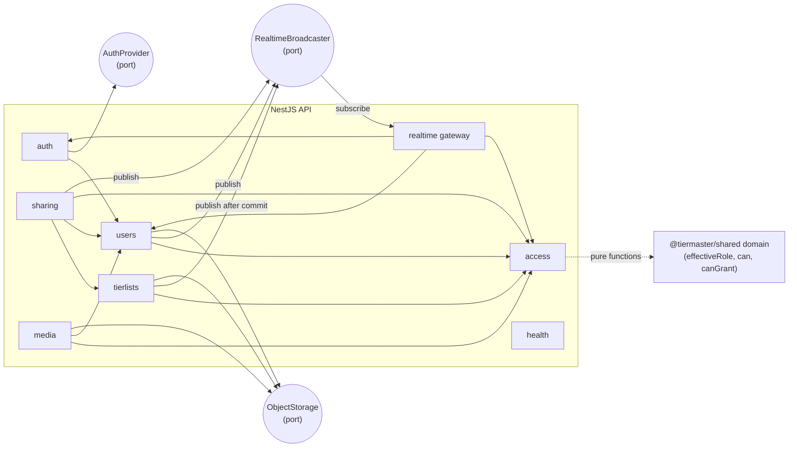
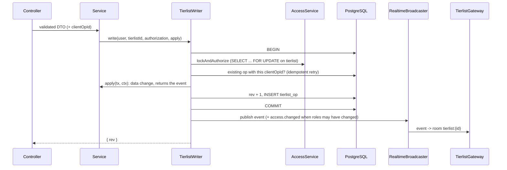

# Architecture

TierMaster is a modular monolith (ADR 0001): one NestJS API, one Angular SPA, a shared TypeScript package, PostgreSQL and Garage.
This page describes the code as built. C1 and C2 diagrams are in this folder; behaviour details are in `docs/features/`.

## Packages

| Package | Role |
| --- | --- |
| `services/shared` (`@tiermaster/shared`) | The front/back contract (`src/types/`, zod schemas) and pure domain logic (`src/domain/`): roles and permissions, fractional indexing, the tierlist event reducer. No I/O, no framework. |
| `services/api` | NestJS REST API and Socket.IO gateway. Only component talking to PostgreSQL (Prisma) and Garage (plain S3 API). |
| `services/front` | Angular SPA (standalone components, signals, Tailwind). Uses the shared schemas to validate every API answer and `can()` to adapt the UI. |

## API modules

- Each module is split by suffix: `*.controller.ts` / `*.gateway.ts` (interface) → `*.service.ts` (logic) → `*.repository.ts` (Prisma).
  No layer imports upwards; modules use each other's exported services, never repositories.
- `access` owns the single `AccessService`: it loads owner, membership and `defaultRole`, calls `effectiveRole` and `can`, and maps
  refusals to 401 (anonymous), 404 (signed in without role, existence hidden) and 403 (role too low).
- Every incoming payload (body, query, params, socket message) is parsed with a schema from `@tiermaster/shared` (`ZodPipe`,
  `UuidPipe`, `JoinRequestSchema`). Every error leaves as `{ statusCode, code, message }` (`ApiExceptionFilter`).

### Ports and adapters

| Port | Adapters | Selected by |
| --- | --- | --- |
| `AuthProvider` | Google, Discord (OAuth 2.0 code flow), Steam (OpenID 2.0), Fake (dev/tests) | credentials present in the environment; `AUTH_FAKE_ENABLED` (refused in production) |
| `ObjectStorage` | `S3ObjectStorage` (`@aws-sdk/client-s3`, Garage), `InMemoryObjectStorage` | `STORAGE_DRIVER` (default `s3` when `S3_ENDPOINT` is set; production requires `s3`) |
| `RealtimeBroadcaster` | `InMemoryBroadcaster` (EventEmitter) | always; Redis pub/sub when several instances are needed |

Prisma is used directly by repositories (no port), through `TransactionRunner` when a service needs a transaction.

## Write path (REST writes, WebSocket broadcasts)

- The tierlist row lock serializes all writes of one tierlist, including member changes, so `rev` has no gaps and a target's
  current role cannot change during a member-management check.
- Positions are fractional keys computed by the server from an anchor (`afterCardId`, `afterId`) with the shared `positionAfter`;
  the client computes the same position for its optimistic update.
- Ops are replayable with `GET /api/tierlists/:id/ops?since=` (same read check, 410 beyond 500 ops).

## Real-time

- Socket.IO on `/ws`. The handshake token is optional (anonymous sockets, capped at VIEWER); a present but invalid token
  disconnects the socket. Tokens are short-lived (5 min) and fetched by the client on every (re)connection.
- `join` resolves the role through `AccessService` and answers `{ ok, effectiveRole, rev }` or `not_found`. Rooms are not kept
  across reconnections, so every reconnection re-checks access.
- `access.changed` (member removed or changed, `defaultRole` changed, account deleted) makes the gateway re-evaluate each
  connected socket: no role left → `access.revoked` and removal from the room; different role → `role.changed`.
  Tierlist deletion sends `access.revoked` (`deleted`) to the room.
- The SPA store keeps the confirmed state plus pending optimistic ops, applies events in `rev` order, fetches missing ops on a
  gap, reloads the snapshot on 410, rolls back on 4xx and retries network errors with the same `clientOpId`.

## Security notes

- Sessions are HMAC-signed, httpOnly, SameSite=Lax cookies; the user is re-read on every request (deleted accounts lose access
  at once). OAuth state is a signed cookie; return URLs must be same-origin paths.
- Emails are never searchable nor returned to other users. Invitation tokens are stored as SHA-256 hashes and shown once.
- Uploads: real type from magic bytes, 5 MB limit, 40 MP decode limit, re-encoded to WebP by sharp (metadata stripped), random
  keys in a private bucket, served through the API with the tierlist read check and `private` caching.
- Rate limiting per user (or IP): writes, uploads and searches. Single-instance, in memory.

## Data model

See `docs/mcd.md` (source of truth) and `services/api/prisma/schema.prisma`.

## Tests

| Level | Where | What |
| --- | --- | --- |
| Unit | `services/shared/src/domain/*.spec.ts` | Exhaustive permission matrix (`effectiveRole`, `can`, `canGrant`), fractional indexing, event reducer |
| Integration | `services/api/test/**` | Real API on a real PostgreSQL (Testcontainers, one database per file), fake `AuthProvider`, multi-client Socket.IO scenarios (broadcast, rejection, revocation), hostile uploads |
| Component | `services/front/src/**/*.spec.ts` | Store logic (optimistic ops, gaps, reconnection, revocation), pages per role, guards, i18n parity |

No automated end-to-end browser tests (AGENTS.md).
