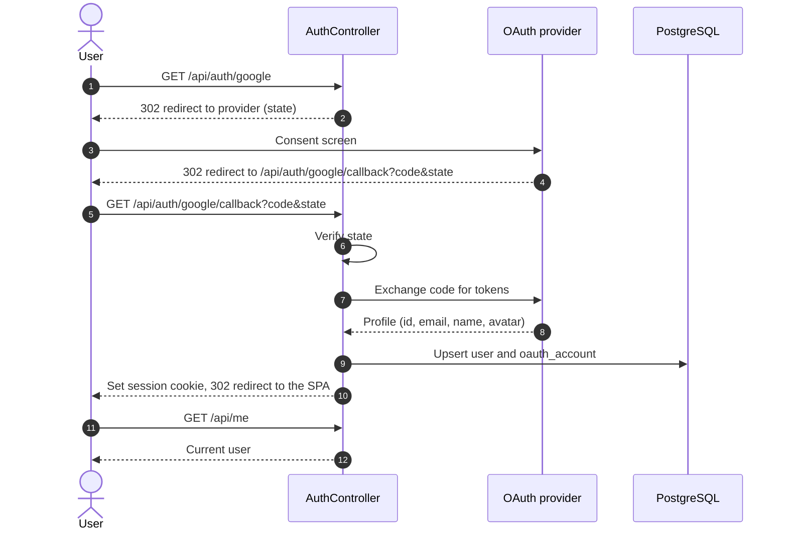

Users sign in with Google, Discord or Steam (production V1 offers Google only, see `docs/production-setup.md`). The API handles the OAuth 2.0 authorization code flow, then issues its own session so the rest of the system never depends on the provider.
The same token or cookie is used to authenticate the Socket.io handshake (see [section 7](#7-real-time-collaboration)).

