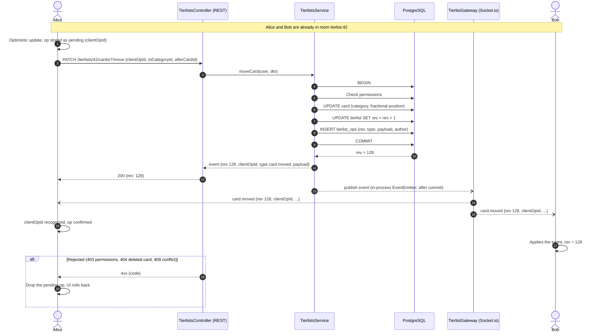
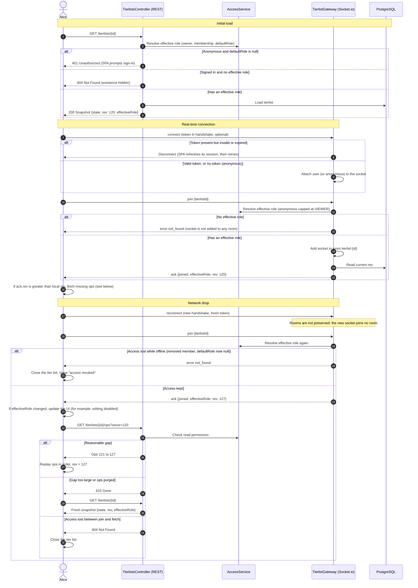
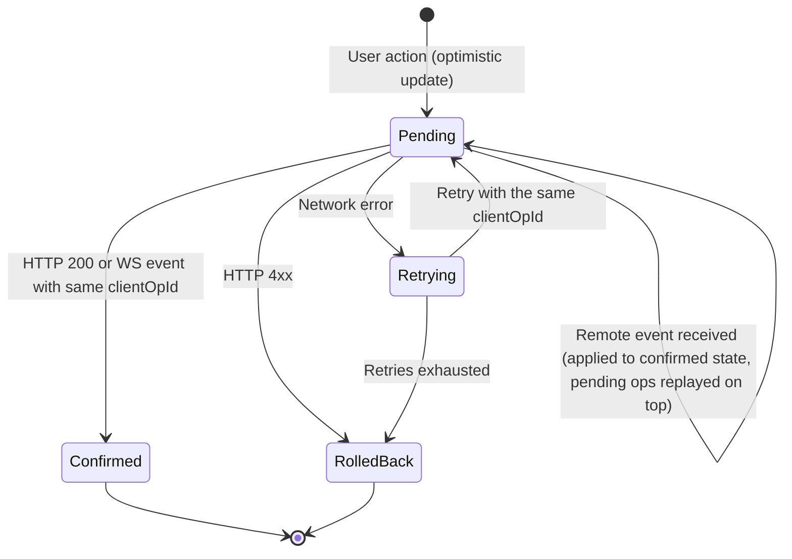

## Principle

- **REST writes, WebSocket broadcasts.** The WebSocket gateway only handles `join` and emits events. It accepts no modification.
- The API applies each change in a **single database transaction**: permission check, data update, `rev` increment, operation log.
- The event is published **after the commit**, so clients never receive an event that could be rolled back.
- Every event carries a **`rev`** number. Clients use it to order events and to detect missing ones.
- Every write carries a **`clientOpId`** generated by the client, so the author can recognize its own event and avoid applying it twice.
- **Conflict policy:** last-write-wins.

## Editing a card

 
Concurrent writes on the same tierlist are serialized by the row lock taken by `UPDATE tierlist SET rev = rev + 1`. This guarantees `rev` values without gaps or duplicates.

## Connection and recovery after a network drop

### Rules

| Topic                         | Rule                                                                                                                                                                                                  |
| ----------------------------- | ----------------------------------------------------------------------------------------------------------------------------------------------------------------------------------------------------- |
| Handshake authentication      | The token is optional. Without one, the socket is anonymous. A token that is present but invalid disconnects the socket, so a signed-in user is never silently downgraded to anonymous                |
| Reconnection                  | Socket.io must read the token through a function (`auth: cb => cb({ token })`), so each reconnection sends a fresh token instead of an expired one                                                    |
| Join authorization            | Requires an effective role, resolved through `AccessService`. Anonymous sockets are capped at `VIEWER` and only succeed when `defaultRole` is not `null`                                              |
| Join failure                  | Returns `not_found` for any user without an effective role, never `forbidden`, so the existence of a private tier list is not leaked                                                                  |
| Rooms after a drop            | Not preserved. The client must call `join` again on every reconnect, which also triggers a fresh permission check                                                                                     |
| Effective role                | Returned by the snapshot and by every `join` ack. The client never infers its own role from replayed ops, so it stays correct even if the relevant events were missed                                 |
| Gap between snapshot and join | The `join` ack carries the current `rev`. If it is higher than the snapshot's `rev`, the client fetches the missing ops. Events received live in the meantime are buffered and applied in `rev` order |
| Ops endpoint                  | `GET /ops?since=` runs the same read-permission check as any REST endpoint. Having been in the room earlier grants nothing                                                                            |
| Anonymous clients             | Same recovery flow. They are read-only, so they have no pending ops to replay                                                                                                                         |

### Edge cases

- **Role changed while offline:** the ack's `effectiveRole` differs from the local one. The UI updates immediately (for example, drag-and-drop disabled after a demotion from `EDITOR` to `VIEWER`). Any pending op the user still had is rejected by the API with `403` and rolled back, as described in ==TBD==.
- **Access removed while connected (no drop):** handled by the server push described in ==TBD==, which re-evaluates the role and evicts the socket if there is no remaining access.
- **Session expired while the socket stays open:** an open socket is not re-authenticated continuously. Anything that matters is protected by the REST layer, which checks the session on every write. The expired session is detected on the next REST call or on the next reconnection.
- **Gap detection while connected:** unchanged. If the client holds `rev = 128` and receives `rev = 130`, it fetches `GET /ops?since=128`.

## Client-side state of an operation
 
The client may learn about the outcome of its own write from two sources (the HTTP response and the WebSocket event), in either order. Whichever arrives first confirms the operation, and the second one is ignored because its `rev` is already applied.
 

 
Reusing the same `clientOpId` on retry lets the server treat the write idempotently (a duplicate returns the original result instead of applying it twice).

