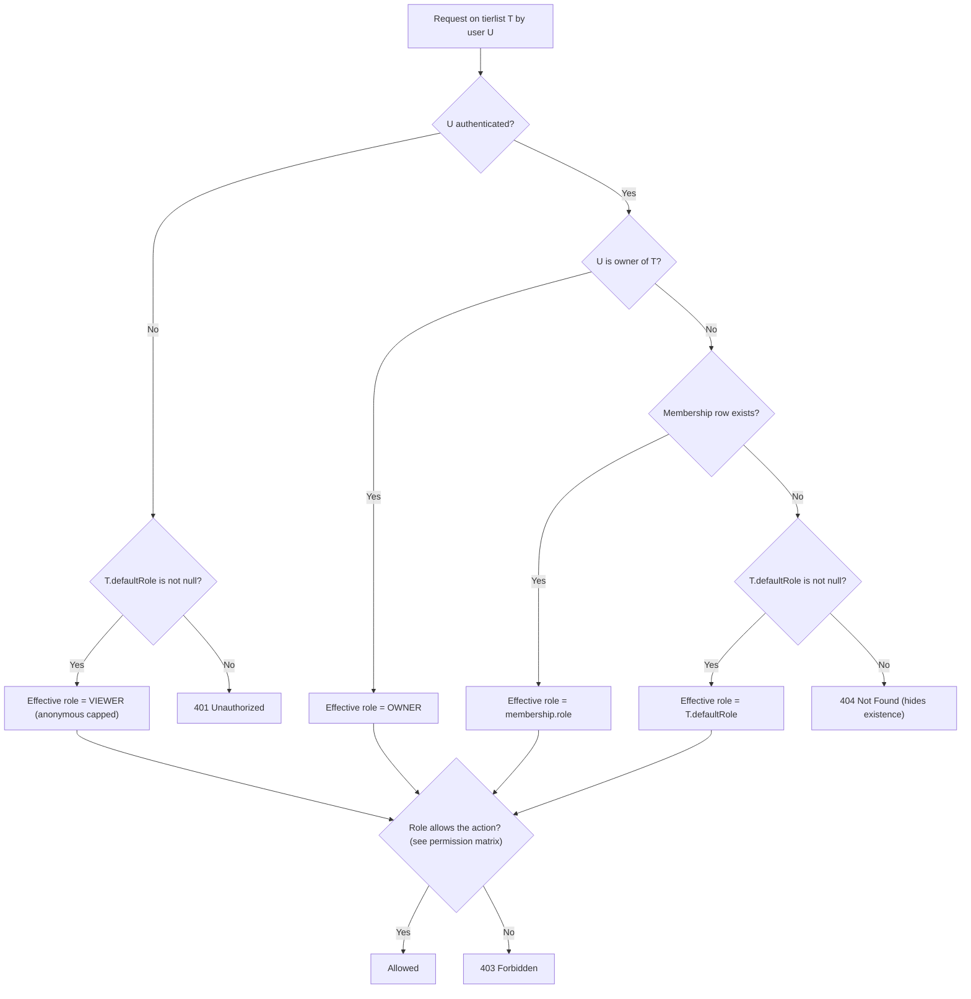
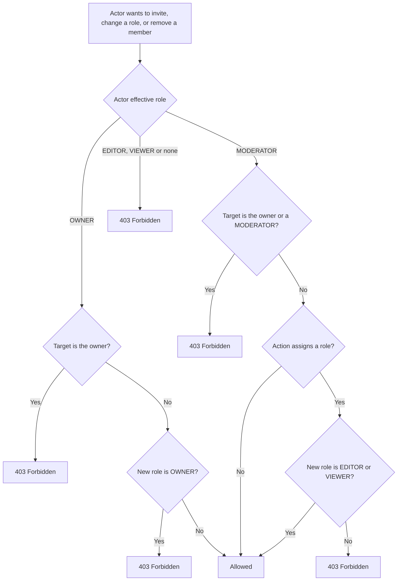
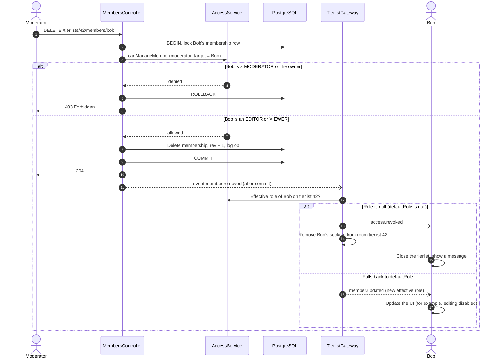

## Roles

Roles ordered from most to least privileged:

| Role          | How it is obtained                                                      |
| ------------- | ----------------------------------------------------------------------- |
| **OWNER**     | `TIERLIST.ownerId`. Exactly one per tierlist                            |
| **MODERATOR** | Explicit membership with role `MODERATOR`, assigned by the owner only   |
| **EDITOR**    | Explicit membership with role `EDITOR`, or the tierlist's `defaultRole` |
| **VIEWER**    | Explicit membership with role `VIEWER`, or the tierlist's `defaultRole` |
| **None**      | No membership and `defaultRole` is `null`                               |

## Default role

Each tierlist has a `defaultRole` field: `EDITOR`, `VIEWER` or `null`. It defines the access of everyone who has **no explicit membership**.

| `defaultRole` | Effect on users without membership                             |
| ------------- | -------------------------------------------------------------- |
| `null`        | No access. The tierlist is private and its existence is hidden |
| `VIEWER`      | Read-only access (equivalent of a "public" tierlist)           |
| `EDITOR`      | Read and edit access                                           |

Rules:

- **An explicit membership always wins over `defaultRole`**, even when it grants less. A member set to `VIEWER` on a tierlist whose `defaultRole` is `EDITOR` can only read. This allows restricting a specific person.
- **Anonymous visitors are capped at `VIEWER`**, whatever the `defaultRole`. Edits must be attributable to an identified user.
- **Only the owner can create or remove moderators**, and only the owner can change `defaultRole` or delete the tierlist.
- **Invitations** inherit the same restriction: a moderator can only create `EDITOR` or `VIEWER` invitations. Accepting an invitation never lowers an existing role.
- **Leaving a tierlist:** any member (including a moderator) can "leave a tierlist" which remove their own membership. The owner cannot leave without transferring ownership. Ownership transfer is not covered yet.

## Permission matrix

| Action                                           | None | Viewer | Editor | Moderator | Owner |
| ------------------------------------------------ | :--: | :----: | :----: | :-------: | :---: |
| Read the tierlist, join the real-time room       |  no  |  yes   |  yes   |    yes    |  yes  |
| Create, edit, delete, move cards                 |  no  |   no   |  yes   |    yes    |  yes  |
| Create, rename, reorder, delete categories       |  no  |   no   |  yes   |    yes    |  yes  |
| Upload card images                               |  no  |   no   |  yes   |    yes    |  yes  |
| Rename the tierlist                              |  no  |   no   |  yes   |    yes    |  yes  |
| Invite members (as Editor or Viewer)             |  no  |   no   |   no   |    yes    |  yes  |
| Change the role of an Editor or Viewer           |  no  |   no   |   no   |    yes    |  yes  |
| Remove an Editor or Viewer                       |  no  |   no   |   no   |    yes    |  yes  |
| Invite, promote to, or demote from **Moderator** |  no  |   no   |   no   |    no     |  yes  |
| Remove or change a **Moderator**                 |  no  |   no   |   no   |    no     |  yes  |
| Change `defaultRole`                             |  no  |   no   |   no   |    no     |  yes  |
| Delete the tierlist                              |  no  |   no   |   no   |    no     |  yes  |

## Resolving the effective role and checking access

The same logic is used by every REST endpoint and by the WebSocket `join`, through a single shared service (`AccessService`).

Error semantics:

- `401`: not signed in and no access. The SPA can prompt a login, since the user may hold a membership.
- `404`: signed in but no effective role. This avoids leaking the existence of a private tierlist.
- `403`: the user has a role but it does not allow the action.

## Authorizing a member-management action

Applies to inviting, changing a role, and removing a member. The check uses the **current** role of the target, read inside the same database transaction as the write (with the membership row locked), so a concurrent role change cannot be exploited.

## Changing access while a user is connected

A removal or a role change must be reflected on open sockets, otherwise a user who lost read access would keep receiving events. The gateway does not evict blindly. It **re-evaluates the effective role**, because a removed member may still have read access through `defaultRole`.

The same re-evaluation runs when the owner changes `defaultRole`. In particular, switching it to `null` evicts every connected socket whose user has no explicit membership.
Permissions are always enforced by the API on each request. The SPA only uses the effective role to hide or disable UI elements.