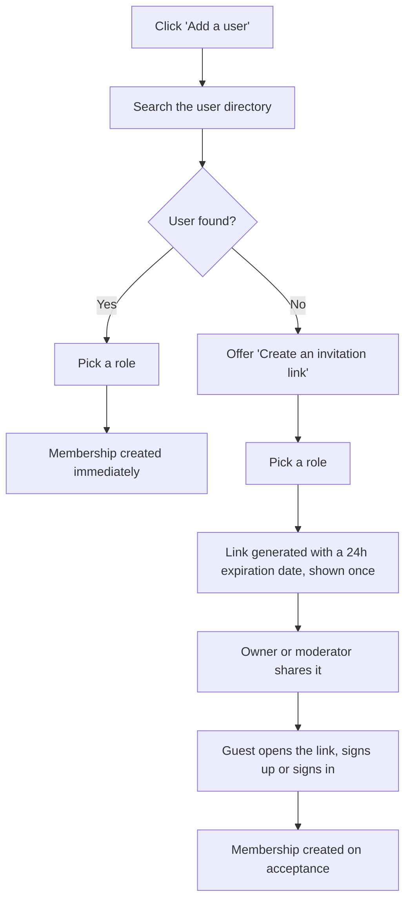
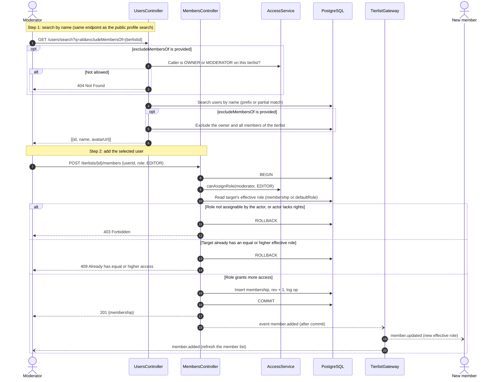
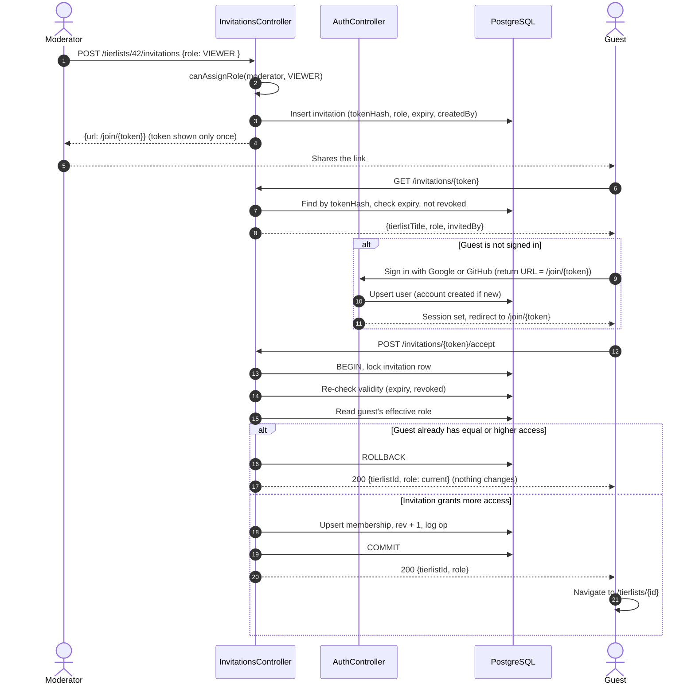

Adding someone to a tier list has two paths, both available in the member management part of the tierlist.

|Path|When|Result|
|---|---|---|
|**Direct add**|The person already has an account|A `MEMBERSHIP` is created immediately|
|**Invitation link**|The person has no account (or cannot be found)|A generic link lets them sign up, then creates their `MEMBERSHIP`|

Both paths are restricted to **OWNER** and **MODERATOR**, and follow the assignable-role rules of [[Roles and permissions#Permission matrix]]: a moderator can only grant `EDITOR` or `VIEWER`, while the owner can also grant `MODERATOR`.

## User flow

## Direct add of an existing user

| Topic                 | Rule                                                                                                                                        |
| --------------------- | ------------------------------------------------------------------------------------------------------------------------------------------- |
| Access                | The endpoint is the same one used to browse profiles and public tier lists. This public endpoints become private with `excludeMembersOf`    |
| Searchable field      | `name` only. **Email is never searchable and never returned**, so a user cannot be found or added by email                                  |
| Response              | `id`, `name`, `avatarUrl` only                                                                                                              |
| Pagination and limits | Minimum 2 or 3 characters, capped result count (about 10 per page), rate limited to prevent scraping                                        |
| `excludeMembersOf`    | Optional tier list UUID. When present, the owner and all current members are removed from the results. When absent, no filtering is applied |
| Notification          | **Direct add is immediate**, with no confirmation from the added user. Notification is not covered yet.                                     |

### Invitation link and account creation

| Topic                | Rule                                                                                                                                                |
| -------------------- | --------------------------------------------------------------------------------------------------------------------------------------------------- |
| Link type            | Generic: anyone holding the link can accept it, including people who already have an account                                                        |
| Validity             | `expiresAt` automatic 24h, and manual revocation                                                                                                    |
| Token storage        | Only a SHA-256 hash is stored. The full link is displayed once at creation                                                                          |
| Token during sign-up | Carried through OAuth as a return URL, so the guest lands back on `/join/{token}`                                                                   |
| No downgrade         | Accepting never lowers access. If the guest already has an equal or higher effective role (including via `defaultRole`), nothing changes            |
| Role cap             | The role is checked against the creator's rights **at creation**. If the creator is later demoted or removed, their pending invitations are revoked |
| Management           | OWNER sees all invitations. A MODERATOR sees and revokes only the ones they created, or ones granting a role they could assign                      |
|                      |                                                                                                                                                     |
