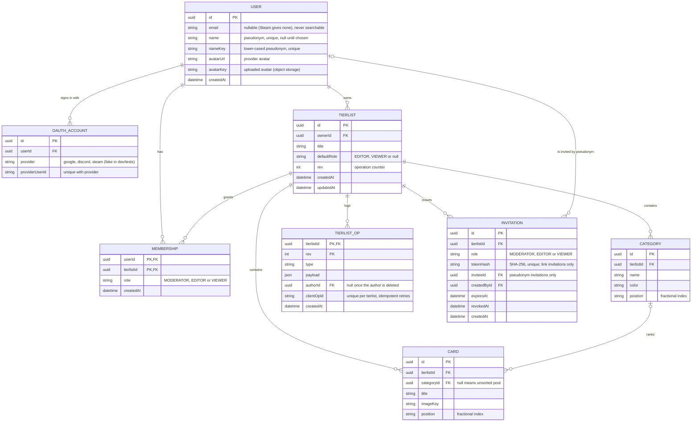

Source of truth for the database. The Prisma schema (`services/api/prisma/schema.prisma`) implements it.

## Notes

- All keys are uuid; foreign keys use the same type as the key they reference.
- Deleting a user cascades to their oauth accounts, owned tierlists, memberships and invitations; their ops keep a `null` author.
- Deleting a tierlist cascades to its categories, cards, memberships, ops and invitations.
- Deleting a category moves its cards to the unsorted pool (`categoryId = null`); the service gives them fresh positions.
- Positions are compared in code-unit order (sorting happens in TypeScript, see `shared/src/domain/fractional-index.ts`).
- An invitation is either a link (`tokenHash` set, generic, reusable until expiry or revocation) or personal
  (`inviteeId` set, accepted or declined once). At most one pending personal invitation per (tierlist, invitee).
